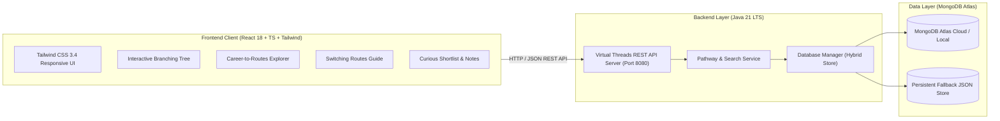

<div align="center">

# 🎓 Education Pathway Explorer
### *Map your education, discover 21st-century careers, and find zero-fear switching routes.*

[](https://ravii07-dev.github.io/education-pathway-explorer/)
[](https://openjdk.org/projects/jdk/21/)
[](https://react.dev/)
[](https://www.typescriptlang.org/)
[](https://www.mongodb.com/)
[](https://tailwindcss.com/)
[](https://www.docker.com/)
[](LICENSE)

</div>

---

## 🌟 The Problem & The Mission

Every year in India, millions of students make life-altering decisions (*choosing streams after 10th, selecting degrees after 12th*) with very little visibility:
- **Narrow Horizon**: Students only know a handful of careers (*engineer, doctor, lawyer, govt exams*) while hundreds of rewarding 21st-century careers exist.
- **Fear of Lock-In**: Students fear that one wrong choice closes all doors forever, because nobody shows them how paths connect or how to switch later.
- **Portals Lack Maps**: Traditional college portals list colleges or ads, but fail to show connected maps from **Current Level ➔ Entrance Exam ➔ Degree ➔ Career Outcome ➔ Lateral Switching Routes**.

**Education Pathway Explorer** is an interactive visual platform that lets students pick where they are today and explore the complete map of possibilities, eliminating lock-in anxiety.

---

## 🏛️ System Architecture



---

## ✨ Key Features Implemented

| # | Feature | Description |
|---|---|---|
| **F1** | **Level Selector** | Select where you are today: **12th Science (PCM)** *(v1 spotlight)*, **After 10th**, **12th PCB**, **12th Commerce**, **12th Arts**, or **College / Graduation**. |
| **F2** | **Branching Pathway Tree** | 3-column linked interactive map: **Entrance Gateways ➔ Undergraduate Programs ➔ Career Outcomes** with active link highlighting and interest domain filtering. |
| **F3** | **Detail Cards & Slide-over Drawer** | Inspect duration, eligibility, government fee vs private fee ranges, entrance exams required, careers unlocked, syllabus, and official links. |
| **F4** | **Career-to-Routes (Reverse Search)** | Pick any target career (e.g. *UX Designer, Data Scientist, Commercial Pilot, Naval Officer, Quant Trader, Defense Officer*) and reveal **Direct Routes, Alternative Routes, and Lateral Bridge paths**. |
| **F5** | **Curious Shortlist** | Bookmark options with 1 click. Add personal notes (*"Discuss with parents"*, *"Check cutoff"*), export as Markdown, or print to PDF. |
| **F6** | **Search & National Directory** | Instant **⌘K / Ctrl+K** global search modal across all courses, careers, exams, and skills. |
| **F7** | **Zero-Fear Switching Routes** | Step-by-step guides for lateral switches: *Engineering to UX Design, Engineering to Product Management, Pure Science to Data Science, Non-Law to Cyber/Patent Law, Diploma to 2nd Year B.Tech, Commerce to FinTech*. |
| **F8** | **Shareable State & Sync** | Encodes your current stage and shortlist in the URL hash for instant sharing. |

---

## 🛠️ Technology Stack

- **Backend**: **Java 21 LTS**
  - **Java 21 Records** for immutable, type-safe data modeling
  - **Virtual Threads** (`Executors.newVirtualThreadPerTaskExecutor()`) for high-concurrency non-blocking I/O
  - Universal CORS for cross-origin frontend communication
- **Frontend**: **React 18**, **TypeScript 5.7**, **Tailwind CSS 3.4**, **Vite 6**, **Lucide Icons**
- **Database**: **MongoDB Atlas Cloud** + resilient persistent document fallback store
- **DevOps**: Docker, Docker Compose, Git, GitHub Actions

---

## 🚀 Quickstart & How to Run

### Method 1: Standard Local Setup

#### 1. Clone the repository
```bash
git clone https://github.com/<your-username>/education-pathway-explorer.git
cd education-pathway-explorer
```

#### 2. Start the Java Backend (JDK 21)
```powershell
cd backend
.\run-backend.ps1
# Backend runs on http://localhost:8080/api
```

#### 3. Start the Frontend (In another terminal)
```powershell
npm install
npm run dev
# Frontend runs on http://localhost:5173 or http://localhost:3000
```

---

### Method 2: 1-Command Docker Setup
```bash
docker compose up --build
```

---

## 📡 REST API Reference

| Method | Endpoint | Description |
|---|---|---|
| `GET` | `/api/health` | Service health status & JVM runtime stats |
| `GET` | `/api/levels` | List of all Indian education stages |
| `GET` | `/api/courses` | Complete undergraduate degree catalogue |
| `GET` | `/api/careers` | 21st-century careers with salaries and education routes |
| `GET` | `/api/exams` | National entrance examinations (JEE, UCEED, NID, etc.) |
| `GET` | `/api/switching-routes` | Zero-fear lateral entries and career transitions |
| `GET` | `/api/search?q={query}` | Global search across degrees, careers, and exams |
| `GET` | `/api/db-status` | Live database connection diagnostics |
| `GET` | `/api/shortlist` | Retrieve saved curious shortlist |
| `POST` | `/api/shortlist` | Save item to persistent shortlist |
| `DELETE`| `/api/shortlist/{type}/{id}` | Remove item from shortlist |
| `POST` | `/api/shortlist/export` | Export shortlist as formatted Markdown |

---

## 📄 License

This project is licensed under the **MIT License** - see the [LICENSE](LICENSE) file for details.
