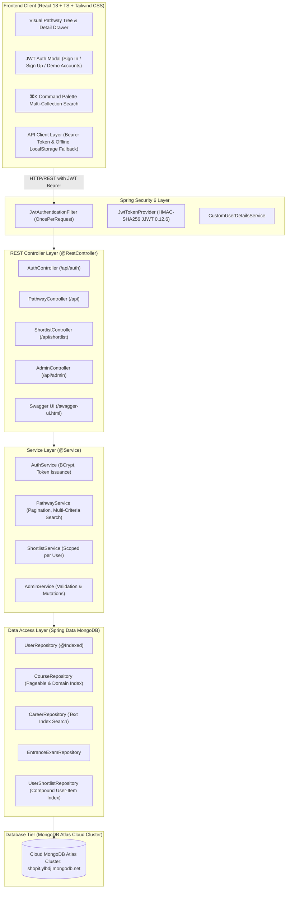

<div align="center">

# 🎓 Education Pathway Explorer (Enterprise Edition)
### *Interactive Full-Stack Platform Mapping Indian Education Streams, 21st-Century Careers, and Zero-Fear Switching Routes*

[](https://ravii07-dev.github.io/education-pathway-explorer/)
[](https://github.com/Ravii07-dev/education-pathway-explorer/actions)
[](https://spring.io/projects/spring-boot)
[](https://openjdk.org/projects/jdk/21/)
[](https://spring.io/projects/spring-security)
[](https://www.mongodb.com/)
[](https://react.dev/)
[](https://www.typescriptlang.org/)
[](http://localhost:8080/swagger-ui.html)
[](https://www.docker.com/)

---

### 🌐 [Click Here to View Live Interactive App](https://ravii07-dev.github.io/education-pathway-explorer/)
*Explore 6 milestones, 20+ undergraduate courses, 35+ high-growth careers, 13 entrance exams, and 12 lateral switching routes.*

</div>

---

## 🌟 The Problem & The Mission

Every year in India, over 15 million students make life-altering decisions (*choosing streams after 10th, selecting undergraduate degrees after 12th*) with very little visibility:
1. **Narrow Career Horizons**: Students typically only know a handful of conventional careers (*software engineer, MBBS doctor, CA, UPSC civil services*), completely unaware of hundreds of high-growth 21st-century careers (*UX Interaction Designer, Actuary, AI/ML Researcher, Quantitative Analyst, Space Systems Engineer*).
2. **Paralyzing Fear of Lock-In**: Students fear that one stream choice permanently shuts down all future options, because traditional education guides never show how lateral skills and bridging pathways connect.
3. **Existing Portals Lack Maps**: Portals list colleges or sponsored ads, but fail to show connected visual maps from **Current Level ➔ Entrance Exam ➔ Degree ➔ Career Outcome ➔ Lateral Switching Routes**.

**Education Pathway Explorer** provides an interactive, graph-driven roadmap that empowers students and parents to make informed, fear-free educational choices.

---

## 🏛️ System Architecture



---

## ⚡ Key Engineering Highlights

### 1. Dual Backend Implementation (Core Java v1 vs Spring Boot v2)
To demonstrate a comprehensive understanding of low-level networking vs enterprise frameworks, this repository contains **both** architectures:
- **`v2-spring-boot` (Main Production Backend)**: Built with Spring Boot 3.3.5, Spring Security 6, Spring Data MongoDB, and Bean Validation.
- **[`v1-core-java`](file:///C:/Users/ravil/.gemini/antigravity/scratch/education-pathway-explorer/backend/v1-core-java/README.md)**: Preserved bare-metal implementation using standard library `HttpServer`, Java 21 **Virtual Threads** (`Executors.newVirtualThreadPerTaskExecutor()`), raw sockets, and manual JSON streaming.

### 2. Spring Security 6 & Stateless JWT Authentication
- Stateless token-based security using **JJWT 0.12.6**.
- Password hashing using industry-standard **BCrypt** with salt.
- Role-based authorization (`ROLE_USER` and `ROLE_ADMIN`).
- User-scoped shortlists: bookmarks are private and isolated per authenticated user ID, with seamless fallback to anonymous guest mode for first-time visitors.

### 3. Spring Data MongoDB with Indexing & Pagination
- **Pagination & Sorting**: Courses and careers support high-efficiency pagination via `Pageable` (`/api/courses?page=0&size=10&domain=Technology&sortBy=code`).
- **Compound & Text Indexes**: Compound indexes on `{ 'domains': 1, 'code': 1 }` and text indexes for instant multi-term keyword search.
- **Auditing**: Automatic timestamp tracking (`@CreatedDate`, `@LastModifiedDate`).

### 4. Interactive Swagger / OpenAPI 3.0 Documentation
- Interactive API documentation available out of the box at [`http://localhost:8080/swagger-ui.html`](http://localhost:8080/swagger-ui.html).
- Supports direct JWT token authorization via the Swagger **Authorize** lock modal.

### 5. Robust Automated Test Suite (14 Tests, 100% Passing)
- **Unit Tests**: Built with JUnit 5 and Mockito testing domain logic in `PathwayServiceTest` and `AuthServiceTest`.
- **Integration Tests**: WebMvc slices testing controller serialization, HTTP status codes, validation constraints, and security filters (`AuthControllerIntegrationTest`, `PathwayControllerIntegrationTest`).
- Continuous Integration verified via GitHub Actions on every push.

---

## 🎯 Design Decisions & Engineering Trade-Offs

| Decision | Alternative Considered | Engineering Rationale |
| :--- | :--- | :--- |
| **MongoDB Document Model** | PostgreSQL / MySQL | Educational pathways are inherently hierarchical, semi-structured, and polymorphic. Storing nested curriculum highlights, career outcomes, and reverse steps in documents eliminated expensive multi-table joins while maintaining sub-millisecond document retrieval. |
| **Stateless JWT Auth** | Stateful HTTP Sessions (JSESSIONID) | Eliminates server-side session memory overhead and allows horizontal scaling across multiple container instances without requiring Redis session synchronization. |
| **Java 21 Virtual Threads** | Traditional Fixed Thread Pools | Virtual threads handle thousands of concurrent I/O-bound database requests with near-zero memory footprint (~few KB per virtual thread vs ~1 MB per platform thread). |
| **Hybrid LocalStorage + Cloud Sync** | Cloud-Only Storage | Ensures first-time visitors can bookmark items immediately without registration barriers; bookmarks are preserved locally and can sync to cloud upon sign-in. |

---

## 🔐 Instant Demo Credentials (For Recruiters & Evaluators)

The backend auto-seeds test credentials on initial startup:

| Role | Username | Password | Permissions |
| :--- | :--- | :--- | :--- |
| **Student** | `student` | `Student@12345` | View pathways, search, manage personal shortlist & notes |
| **Administrator** | `admin` | `Admin@12345` | Full access + Admin endpoints (`/api/admin/courses`, `/api/admin/stats`) |

*You can also click the **"Demo Student"** or **"Admin Mode"** buttons in the frontend login modal for instant 1-click authentication.*

---

## 🚀 Running the Project Locally

### 1. Clone the repository
```bash
git clone https://github.com/Ravii07-dev/education-pathway-explorer.git
cd education-pathway-explorer
```

## 🚀 Running the Project Locally

### Prerequisites
- **JDK 21 LTS** or newer
- **Node.js 20+** and `npm`

### Option 1: Run Full Stack Locally

1. **Start the Spring Boot Backend**:
   ```bash
   cd backend
   ./mvnw clean test
   ./mvnw spring-boot:run
   ```
   *The backend starts at `http://localhost:8080` and connects directly to cloud MongoDB Atlas.*

2. **Start the React Frontend**:
   ```bash
   npm install
   npm run dev
   ```
   *Frontend starts at `http://localhost:3000`.*

### Option 2: Run with Docker Compose

```bash
docker compose up --build
```

---

## 📄 API Endpoints Reference

| Method | Endpoint | Description | Access |
| :--- | :--- | :--- | :--- |
| `POST` | `/api/auth/signup` | Register new account and obtain JWT | Public |
| `POST` | `/api/auth/login` | Authenticate and obtain JWT Bearer token | Public |
| `GET` | `/api/auth/me` | Retrieve authenticated user profile | Authenticated |
| `GET` | `/api/levels` | List education milestones | Public |
| `GET` | `/api/courses` | List courses (supports `page`, `size`, `domain`, `sortBy`) | Public |
| `GET` | `/api/careers` | List careers (supports `page`, `size`, `domain`, `sortBy`) | Public |
| `GET` | `/api/exams` | List entrance exams (supports `difficulty` filter) | Public |
| `GET` | `/api/switching-routes` | List lateral career switching paths | Public |
| `GET` | `/api/search?q={query}` | Global search across all collections | Public |
| `GET` | `/api/shortlist` | Get user's saved bookmarks | Scoped to User |
| `POST` | `/api/shortlist` | Bookmark a course, career, or exam | Scoped to User |
| `DELETE`| `/api/shortlist/{type}/{id}`| Remove an item from shortlist | Scoped to User |
| `POST` | `/api/admin/courses` | Create new course | `ROLE_ADMIN` |
| `GET` | `/api/admin/stats` | System counts across users & collections | `ROLE_ADMIN` |

---

## 📜 License

Distributed under the **MIT License**. See `LICENSE` for details.
